# NN-preference-modeling


Repository for the engineering thesis **"Modeling comparison of alternatives using neural networks"** (_Modelowanie porównywania alternatyw za pomocą sieci neuronowych_).

The thesis designs and trains a neural network that derives the priority weight vector from an AHP pairwise comparison matrix. The goal is to derive weights more stably than classical methods, especially when the expert's judgments are inconsistent. The key element is a custom three-term loss function, and the model is benchmarked against the Eigenvalue Method (EVM).

## Table of contents

- [Approach overview](#approach-overview)
- [Monte Carlo dataset](#monte-carlo-dataset)
- [Model](#model)
- [Loss function](#loss-function)
- [Results](#results)
  - [1. Hyperparameter optimization](#1-hyperparameter-optimization)
  - [2. Loss function selection](#2-loss-function-selection)
  - [3. Training the final model](#3-training-the-final-model)
  - [4. Comparison with EVM](#4-comparison-with-evm)
  - [5. Effect of the number of criteria](#5-effect-of-the-number-of-criteria)
- [Conclusions](#conclusions)
- [Repository structure and usage](#repository-structure-and-usage)

## Approach overview

```
weight vector w ~ Dirichlet(α)  →  consistent matrix a_ij = w_i / w_j  →  log-normal noise
      →  discretization to Saaty's scale  →  stratification by CR  →  train / val / test

matrix A (n×n)  →  ln(a_ij) for i < j  →  MLP (funnel)  →  logits s  →  softmax  →  weights ŵ
```

Training is **unsupervised**: the loss function uses only the input matrix. The ground-truth weight vectors sampled from the Dirichlet distribution are used for evaluation only.

## Monte Carlo dataset

There are too few real comparison matrices to train a network, so the data is generated synthetically ([monte_carlo_generator.py](data_augmentation/generator/monte_carlo_generator.py), [monte_carlo_data_generator.py](data_augmentation/monte_carlo_data_generator.py)):

1. **Weight vectors** are sampled from a Dirichlet distribution with $\alpha = 2$, which concentrates weights around $1/n$ and needs no normalization.
2. **A consistent matrix** is built from the weights using $a_{ij} = w_i / w_j$.
3. **Multiplicative noise** $a'_{ij} = a_{ij} \cdot \varepsilon_{ij}$, where $\varepsilon_{ij} \sim \mathrm{LogNormal}(0, \sigma)$, is applied to the upper triangle only. The lower triangle holds the reciprocals.
4. **Discretization** rounds each judgment to the nearest value of Saaty's scale $\{1/9, \ldots, 1, \ldots, 9\}$ in log space.
5. **Stratification** splits the matrices by the consistency ratio (CR):

| Inconsistency level | CR range             | Share |
| :------------------ | :------------------- | :---: |
| Low                 | $CR \le 0.10$        |  40%  |
| Moderate            | $0.10 < CR \le 0.33$ |  50%  |
| High                | $CR > 0.33$          |  10%  |

Each stratum is split into training, validation and test sets in an **80 / 10 / 10** ratio. A separate dataset was generated for each $n \in \{3, \ldots, 9\}$, from 250k matrices for $n = 3$ to 850k for $n = 9$.

| n                 |       3 |       4 |       5 |       6 |       7 |       8 |       9 |
| :---------------- | ------: | ------: | ------: | ------: | ------: | ------: | ------: |
| training          | 200,000 | 280,000 | 360,000 | 440,000 | 520,000 | 600,000 | 680,000 |
| validation / test |  25,000 |  35,000 |  45,000 |  55,000 |  65,000 |  75,000 |  85,000 |

## Model

A funnel-shaped multi-layer perceptron ([dense_monte_carlo.py](model/architecture/dense_monte_carlo.py)):

- **Input:** $K = \frac{n(n-1)}{2}$ log-transformed judgments from the upper triangle of the matrix. The logarithm turns the multiplicative scale of judgments into an additive one.
- **Hidden layers:** the first has `expansion_factor · K` neurons, and each next one has half as many as the previous. Each layer is followed by LeakyReLU and Dropout, and weights use He initialization.
- **Output:** $n$ logits, turned by softmax into a vector of positive weights that sum to 1.
- **Augmentation:** rows and columns of the matrix are permuted symmetrically together with the weight vector, because an MLP is not invariant to the order of criteria.
- **Matrix size:** a separate network is trained for each $n$.

## Loss function

$$L = \lambda_{FIT} \, L_{fit} + \lambda_{COP} \, L_{COP} + \lambda_{STAB} \, L_{stability}$$

Implementation: [custom_dense_MC_loss.py](model/loss_function/dense_monte_carlo/custom_dense_MC_loss.py).

| Term                       | Formula                                                                | Role                                                                      |
| :------------------------- | :--------------------------------------------------------------------- | :------------------------------------------------------------------------ |
| $L_{fit}$                  | $\frac{2}{n(n-1)} \sum_{i<j} \lvert (s_i - s_j) - \ln a_{ij} \rvert^p$ | fits weight ratios to the expert's judgments in log space                 |
| $L_{COP}$ (Margin)         | $\sum_{a_{ij} > 1} \max(0, -(s_i - s_j) + m)$                          | preserves the order of preferences with a separation margin $m$           |
| $L_{COP}$ (Bradley)        | $\sum_{a_{ij} > 1} \ln(1 + e^{-(s_i - s_j)})$                          | probabilistic variant based on the Bradley-Terry model                    |
| $L_{stability}$ (Kullback) | $D_{KL}(w \parallel u) = \sum_i w_i \ln(w_i \cdot n)$                  | penalizes overly extreme weights (distance from the uniform distribution) |
| $L_{stability}$ (Rényi)    | $\ln n - H_q(w)$                                                       | variant based on Rényi entropy                                            |

Since $\ln(w_i / w_j) = s_i - s_j$ for softmax weights, the fit term needs no division of weights and is numerically stable.

## Results

Hyperparameter optimization and loss function selection were performed for matrices with $n = 5$. Evaluation is done on the test set against the ground-truth weight vectors, using two metrics:

- **MAE**: mean absolute error of the weights,
- **Kendall's τ**: agreement of the criteria ranking.

### 1. Hyperparameter optimization

A full grid search would require 41,472 models. Instead, **coordinate search** was used: hyperparameters are tuned one at a time in a random order, and the whole process is repeated several times. The selection criterion was validation MAE.

**Network depth.** Networks with 3, 4 and 5 layers give similar results, and the 4-layer architecture is the best, with MAE 0.0419 / 0.0421 / 0.0462 for the successive inconsistency levels. From 6 layers on, the error clearly grows, reaching 0.085–0.090 for 7–8 layers. A deep funnel creates an information bottleneck, and the network returns overly flattened weights.

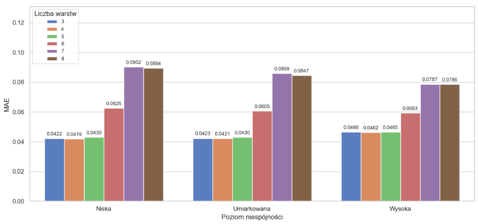

**Width of the first layer.** Narrow networks (expansion factor 1–2) quickly stall on a high plateau. Expansion factors 12 and 24 are the best, with validation MAE ≈ 0.0420. The widest setting shows signs of overfitting.

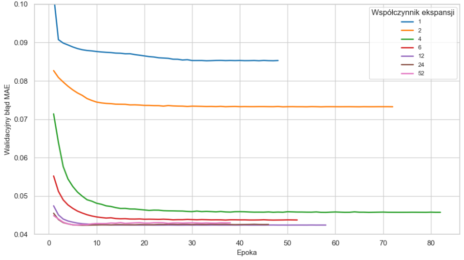
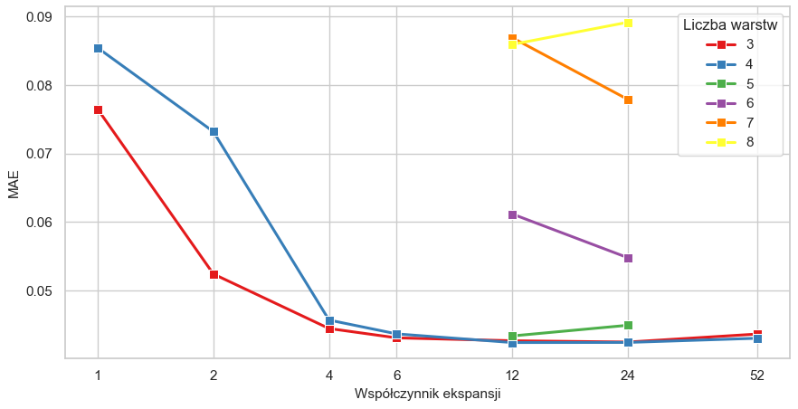

**Regularization.** A Dropout rate of 0.2 is optimal, with 0.1 and 0.3 giving similar results. Without Dropout the network partly fits the noise, and at 0.5 it underfits. Batch normalization worsens the result and makes the error oscillate, which matches the conflict between BatchNorm and Dropout described in the literature.

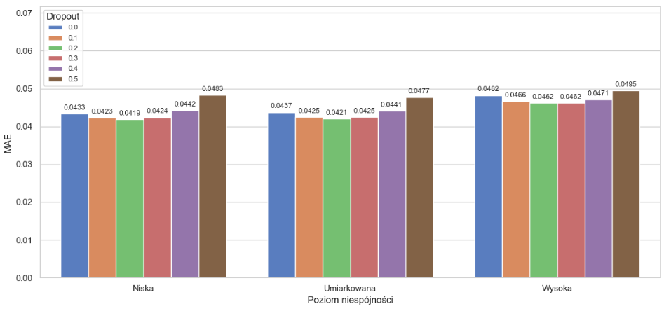
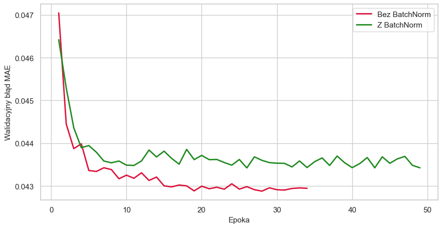

**Final configuration:**

| layers | expansion_factor | dropout_rate | negative_slope | learning_rate | batch_size | batch_norm |
| :----: | :--------------: | :----------: | :------------: | :-----------: | :--------: | :--------: |
|   4    |        12        |     0.2      |      0.5       |   $10^{-4}$   |    512     |   False    |

### 2. Loss function selection

**Term weights** were chosen from a grid with a step of 0.1, subject to $\lambda_{COP} + \lambda_{FIT} + \lambda_{STAB} = 1$:

- MAE forms a wide plateau of 0.0433–0.0434 for $\lambda_{FIT} \in [0.4, 0.7]$ and $\lambda_{COP} \in [0.2, 0.5]$.
- Raising $\lambda_{STAB}$ above 0.2 clearly worsens the results.
- The network tolerates a lower FIT weight worse than a lower COP weight, because COP alone carries no information about the scale of the weights.
- Kendall's τ stays within 0.7056–0.7070.

|                                                                          |                                                                                  |
| :----------------------------------------------------------------------: | :------------------------------------------------------------------------------: |
|  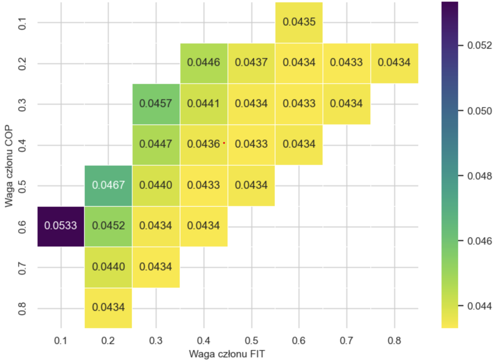  |  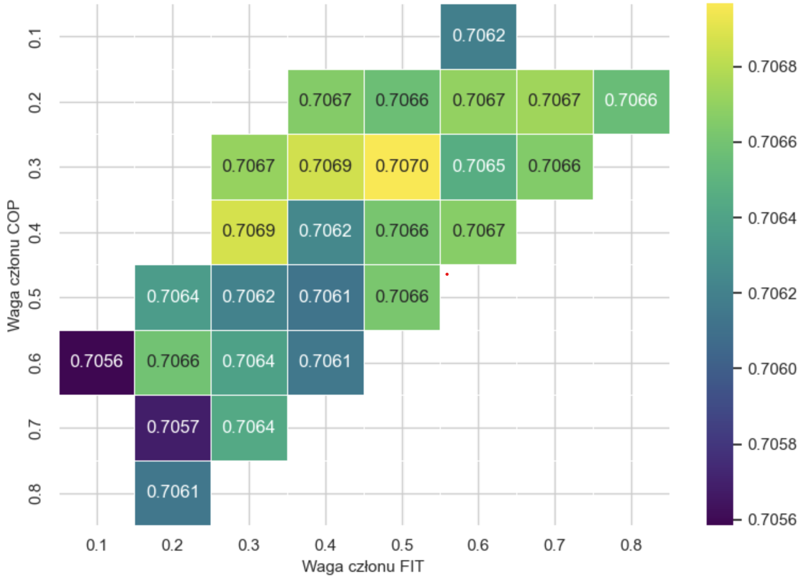   |
| 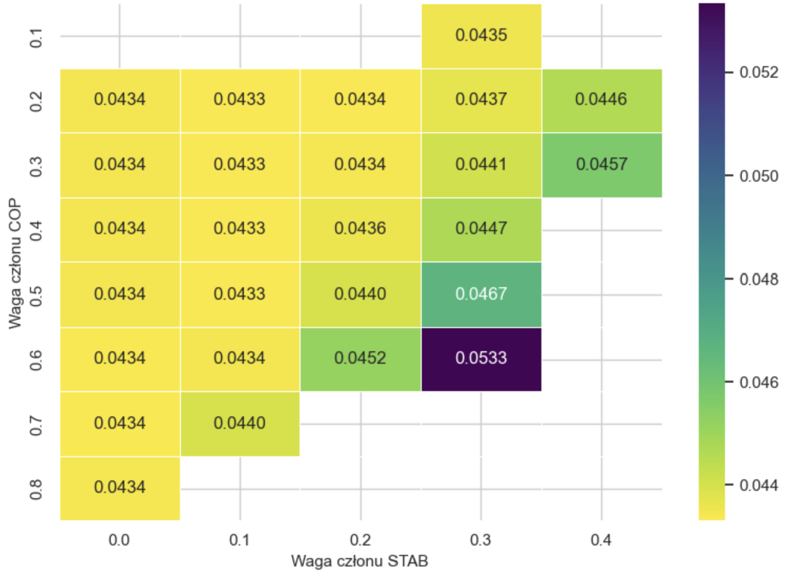 | 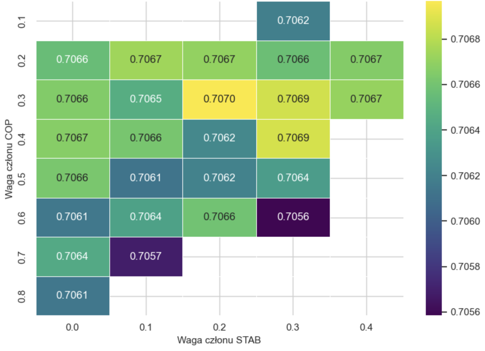 |

**Term variants.** The choice of variant has little effect on the result. Still:

- $p = 2$ is never worse than $p = 1$,
- KL divergence beats Rényi entropy,
- the Bradley-Terry variant has a stable MAE but preserves the ranking worse than the margin variant.

|                                                                     |                                                                             |
| :-----------------------------------------------------------------: | :-------------------------------------------------------------------------: |
| 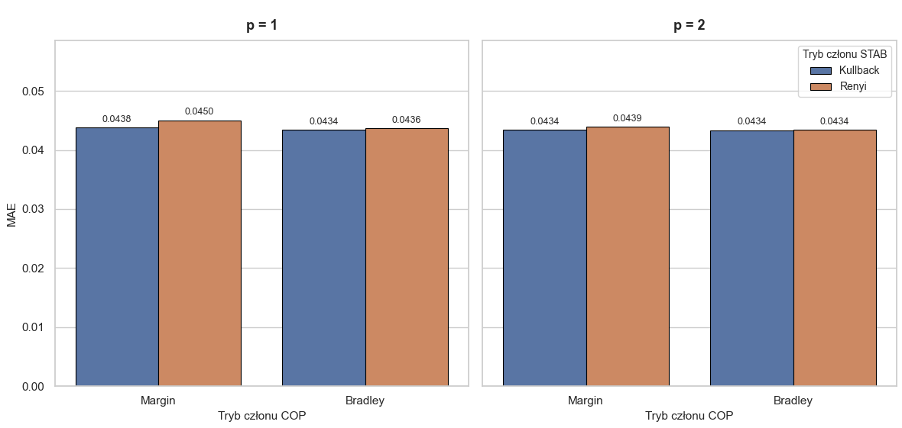 | 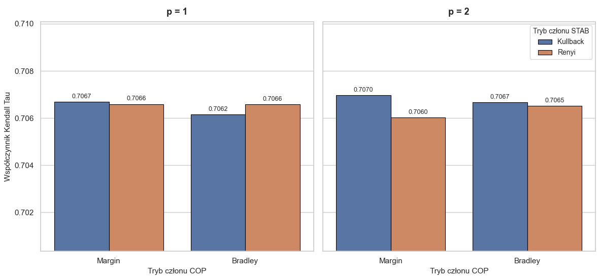 |

**Final configuration** (MAE = 0.0434, τ = 0.7070):

| $\lambda_{COP}$ | $\lambda_{FIT}$ | $\lambda_{STAB}$ |  COP   | FIT ($p$) |       STAB       | margin $m$ |
| :-------------: | :-------------: | :--------------: | :----: | :-------: | :--------------: | :--------: |
|       0.3       |       0.5       |       0.2        | Margin |     2     | Kullback-Leibler |    0.05    |

### 3. Training the final model

- Training loss drops from 1.08 to 0.27, and validation loss from 0.27 to 0.21.
- The best model, from epoch 27, has a validation MAE of 0.0426.
- Early stopping triggered at epoch 42, and the learning rate was halved at epochs 33 and 39 (from $10^{-4}$ to $2.5 \cdot 10^{-5}$).
- Training took about 21 minutes.
- Validation loss is lower than training loss because Dropout is active only during training.

The FIT term dominates the total loss. The COP term drops almost to zero within the first epochs, and STAB stays at a constant low level of about 0.03.

|                                                                  |                                                                         |
| :--------------------------------------------------------------: | :---------------------------------------------------------------------: |
| 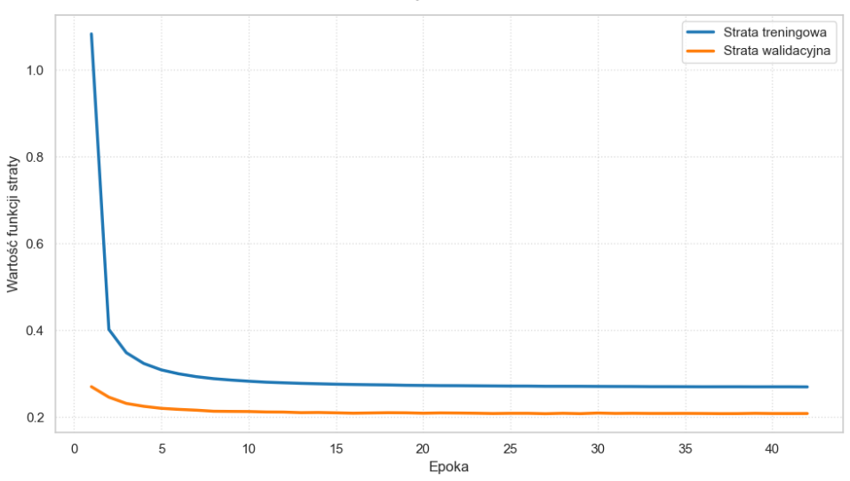 | 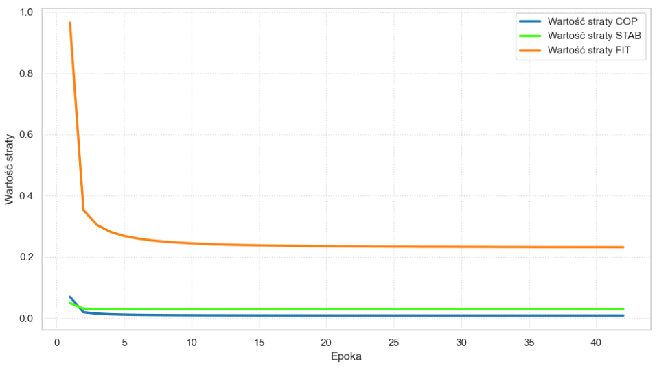 |

### 4. Comparison with EVM

Test set, $n = 5$:

| Inconsistency level | mean CR |   MAE NN   | MAE EVM | MAE improvement |    τ NN    | τ EVM  |
| :------------------ | :-----: | :--------: | :-----: | :-------------: | :--------: | :----: |
| Low                 |  0.065  | **0.0421** | 0.0440  |      4.3%       | **0.7401** | 0.7392 |
| Moderate            |  0.179  | **0.0422** | 0.0447  |      5.6%       | **0.7227** | 0.7177 |
| High                |  0.431  | **0.0460** | 0.0509  |      9.6%       | **0.6582** | 0.6278 |

|                                                    |                                                            |
| :------------------------------------------------: | :--------------------------------------------------------: |
| 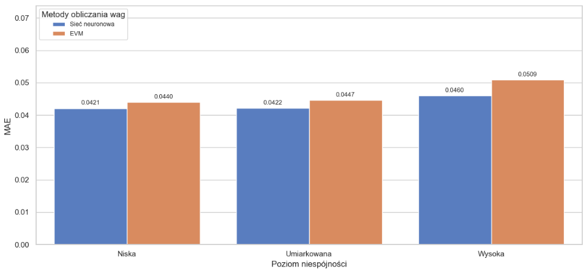 | 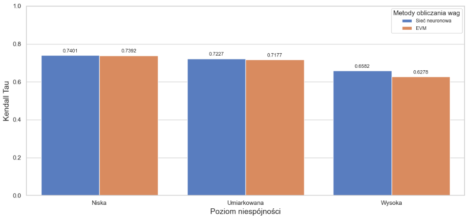 |

- The network has a lower MAE than EVM at every inconsistency level, and its advantage grows with inconsistency.
- Between the extreme inconsistency levels, EVM's MAE grows by 15.7% and the network's by 9.3%. Kendall's τ drops by 15.1% and 11.1% respectively.
- At low inconsistency, the τ difference (0.0009) is within statistical error.
- At moderate inconsistency, i.e. above Saaty's threshold $CR = 0.1$, the network's MAE is 4.1% lower than EVM's MAE on low-inconsistency matrices. At high inconsistency it is only 4.5% higher.

### 5. Effect of the number of criteria

A separate network was trained for each $n \in \{3, \ldots, 9\}$ with the same hyperparameters and loss function.

| n       |     3     |     4     |     5     |     6     |     7     |     8     |     9     |
| :------ | :-------: | :-------: | :-------: | :-------: | :-------: | :-------: | :-------: |
| MAE NN  | **0.085** | **0.058** | **0.044** | **0.034** | **0.029** | **0.025** | **0.022** |
| MAE EVM |   0.093   |   0.062   |   0.047   |   0.037   |   0.030   |   0.026   |   0.022   |
| τ NN    |   0.615   | **0.672** | **0.707** | **0.731** | **0.748** | **0.761** | **0.769** |
| τ EVM   | **0.618** |   0.667   |   0.695   |   0.716   |   0.732   |   0.744   |   0.752   |

_Values read from the plots, averaged over inconsistency levels._

|                                                                                                          |                                                                                                                  |
| :------------------------------------------------------------------------------------------------------: | :--------------------------------------------------------------------------------------------------------------: |
|           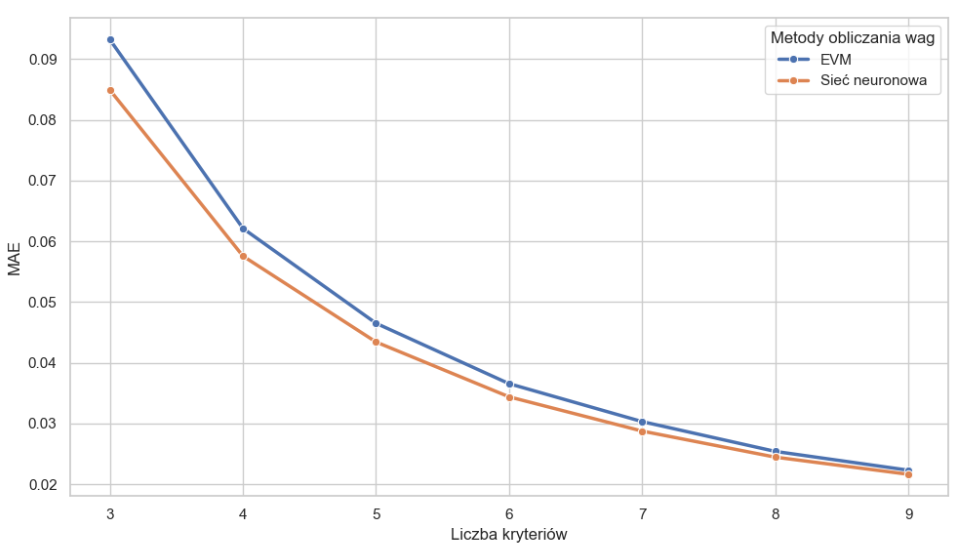           |           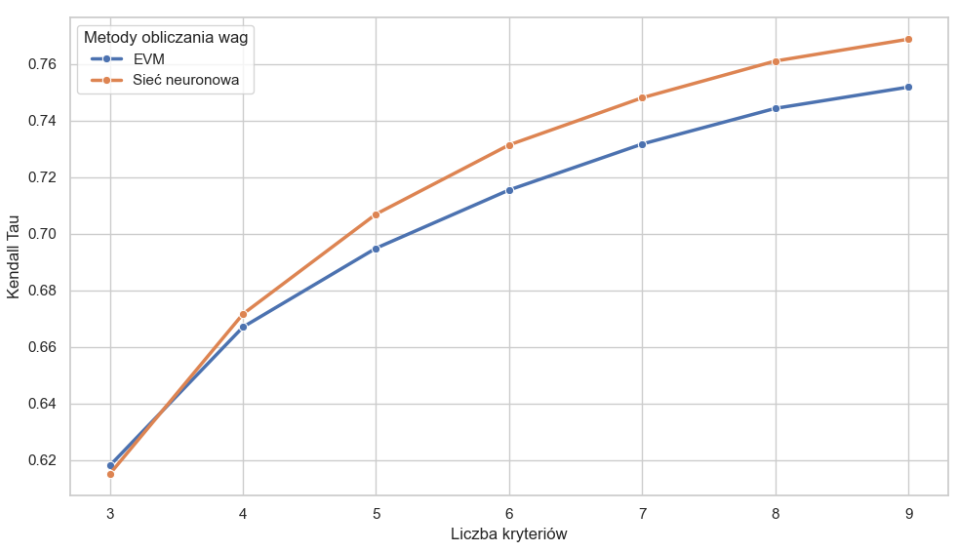           |
| 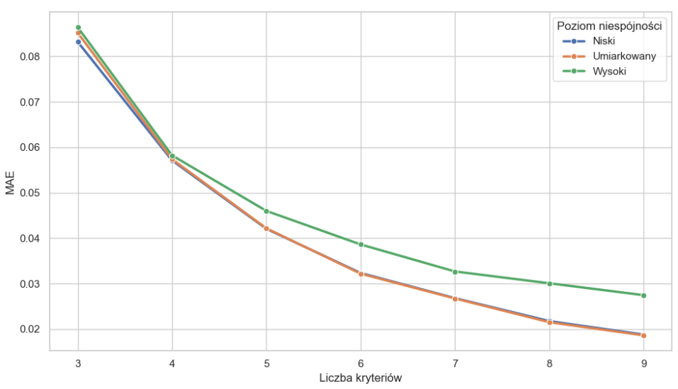 | 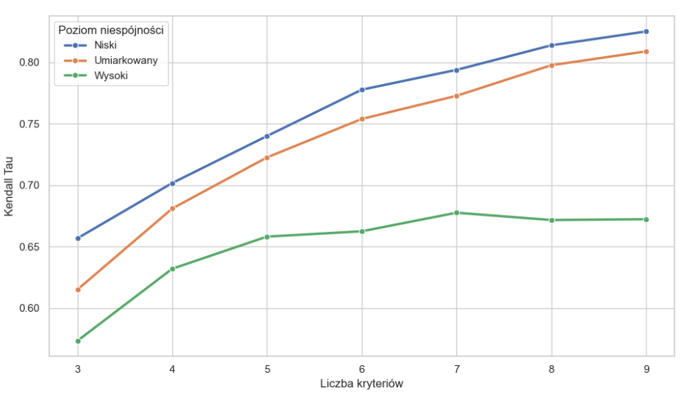 |

- **The MAE advantage shrinks with matrix size**: about 9% for $n = 3$ and about 3% for $n = 9$.
- **The τ advantage grows with matrix size**: from +0.005 for $n = 4$ to about +0.017 for $n \ge 7$. Only for $n = 3$ is the network slightly worse. For 3×3 matrices, EVM gives the same weights as the geometric mean method, which the $L_{fit}$ term reproduces.
- **The drop in MAE with $n$ is largely a scale effect**: the average weight is $1/n$, so MAE values for different $n$ are not directly comparable.
- **τ grows with $n$ for low and moderate inconsistency** (up to 0.826 and 0.809 for $n = 9$). A larger matrix holds more redundant comparisons: $\frac{n(n-1)}{2}$ judgments for $n - 1$ degrees of freedom.
- **At high inconsistency, τ levels off at ~0.67–0.68** from $n = 7$ on, and the MAE gap between the high- and low-inconsistency strata grows to about 45% for $n = 9$.

## Conclusions

- An MLP trained without access to the true weights, using only the comparison matrices and the custom loss function, **performs at least as well as EVM** in every tested configuration except τ for $n = 3$.
- **The network's advantage grows with data inconsistency**, which is exactly where classical methods are least reliable.
- The best loss configuration is **COP with margin + FIT with $p = 2$ + KL-divergence STAB**, weighted 0.3 / 0.5 / 0.2.
- **A simpler, shallower architecture works better**: 4 layers with a wide first layer, moderate Dropout and no batch normalization.

## Repository structure and usage

```
analytic_methods/          classical methods (EVM)
data_augmentation/         Monte Carlo generator, loader, PyTorch datasets
metrics/                   MAE, Kendall's τ, inconsistency indices
model/architecture/        DenseMonteCarloNet (MLP) and earlier architectures
model/loss_function/       custom loss function (dense_monte_carlo/)
model/trainers/            training loop, early stopping, ReduceLROnPlateau
models/dense_optimized/    trained models and training histories (criteria{n}/)
visualization/             result plots
docs/results/              plots used in the thesis
```

Notebooks:

| Notebook                               | Contents                                                                       |
| :------------------------------------- | :----------------------------------------------------------------------------- |
| `MC_hiperparameter_optimization.ipynb` | hyperparameter optimization                                                    |
| `MC_hiperparameters_results.ipynb`     | analysis of optimization results                                               |
| `MC_dense_training.ipynb`              | training models for all $n$                                                    |
| `MC_final_results.ipynb`               | loss function selection, comparison with EVM, effect of the number of criteria |

Usage:

```bash
pip install -r requirements.txt          # or requirements-gpu.txt
python generate_monte_carlo.py           # generate data for n = 3..9
python generate_monte_carlo.py --criteria 5 --seed 42
```

Earlier experiments with Siamese and graph neural networks (`siamese_training.ipynb`, `graph_training.ipynb`) were not included in the final version of the thesis. Section 4.1 of the thesis explains why these architectures were rejected.

## Author

Konrad Ćwięka
